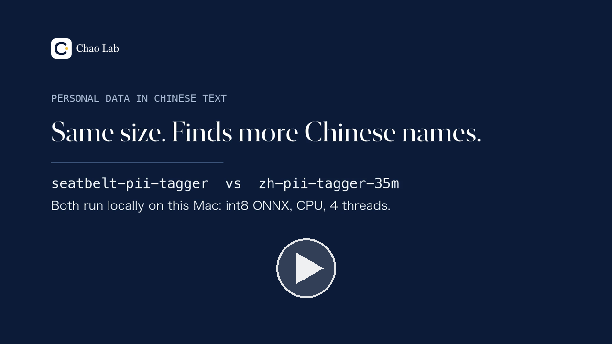

# zh-pii-tagger-eval

Training and evaluation code for [`ickma2311/zh-pii-tagger-35m`](https://huggingface.co/ickma2311/zh-pii-tagger-35m),
a 35M Chinese / English PII token tagger fine-tuned from
[`cjhwong/seatbelt-pii-tagger`](https://huggingface.co/cjhwong/seatbelt-pii-tagger). The repository also includes
four Chinese test sets:
- **zh-pii-ctx-heldout** (`data/e2.jsonl`): 1,875 passages. It was used during development. It is built with the
  same generator code as the training data, but with disjoint name pools and different contexts and templates.
- **zh-pii-fresh** (`data/fresh.jsonl`) and **zh-pii-fresh-2** (`data/fresh2.jsonl`): 2,000 passages each, built
  after release from new contexts. They share no Wikipedia article; 13 of the 1,300 LCCC dialogue contexts in each
  set are short contexts that appear in both. The names and addresses come from Faker, inserted by templates
  written independently of the training generator.
- **zh-pii-numaddr** (`data/numaddr.jsonl`): 1,200 short messages for addresses written without a street or city
  (room, door, building or unit numbers) and for numbers that are not addresses. Its generator could not see the
  optional filter, but its templates were based partly on the same example sentences as the filter's word list;
  58 positive templates.

The model card has the result tables and limits. The main model on Hugging Face is v1.0. In short, compared with the base model:
- this model misses fewer Chinese person names: recall is about 2 to 10 points higher on test sets never used
  during development, while precision moves between −3.5 and +3.5 points;
- person F1 gains are modest: +0.6 to +2.1 on zh-pii-fresh and zh-pii-fresh-2, +4.2 to +6.7 on an MSRA train
  sample and +3.3 to +5.7 on the MSRA test split; on Weibo and CLUENER they are not significant under the base
  model's own decoder;
- on PII Bench ZH person it is slightly below the base model under the base model's own decoder (−0.4 to −0.65;
  −1.0 with the released int8 on an x86 CPU);
- addresses: no consistent improvement over the base model. The optional `postprocess/cue_filter.py` (off by
  default) removes predicted addresses that are a bare number with no address word nearby: most address
  predictions in messages without an address go, at a cost of about 33 points of recall on addresses written as
  digits alone;
- int8 scores depend on the CPU.

This is not a state-of-the-art or across-the-board improvement.

## Demo

[](https://huggingface.co/ickma2311/zh-pii-tagger-35m/blob/main/demo/zh-pii-tagger-demo.mp4)

A 3.5-minute comparison of this model and the base model, both running locally (int8 ONNX on a Mac CPU): five
fictional messages, the held-out set, the test sets never used during development, and the address trade-off.
English narration, with English and Chinese captions burned in. The video is hosted on Hugging Face; caption files:
[English](https://huggingface.co/ickma2311/zh-pii-tagger-35m/blob/main/demo/zh-pii-tagger-demo.en.srt), [Chinese](https://huggingface.co/ickma2311/zh-pii-tagger-35m/blob/main/demo/zh-pii-tagger-demo.zh.srt).

## Files

| file | what it does |
|---|---|
| `pools.py` | entity pools (names, addresses, ...), split by a stable hash into a training half and an evaluation half |
| `build_e2.py` | builds zh-pii-ctx-heldout from LCCC test and zh-Wikipedia contexts, using the evaluation half |
| `build_train_n.py` | builds training passages from FineWeb-2 `cmn_Hani` contexts, using the training half; checks that no held-out name or context leaks; use `--v2` to build the released model's data |
| `train_eval.py` | replay self-labelling with the base model, training (the released model, a matched-step replay-only ablation, and a second model family as a check), evaluation (Kaggle T4); `--addr-clean` relabels the base model's number-only "addresses" as not-an-address (the withdrawn v1.1) |
| `eval_rules.py` | non-model baselines (jieba nr + regex, argus-redact fast) |
| `qwen_baseline.py` | Qwen3-8B prompted baseline |
| `export_bench.py` | int8 ONNX export (eager attention, ORT BERT fusion, dynamic int8) and CPU latency vs the base model |
| `check_convention.py` | address-span check against the base model |
| `metrics.py` | shared CoNLL reader and per-document counts |
| `confirm/gen_fresh.py` | builds zh-pii-fresh from LCCC valid and new zh-Wikipedia articles, with Faker 40.43.0 entities; `FRESH_SEED=20261015` with `FRESH_EXCLUDE=<zh-pii-fresh>` builds zh-pii-fresh-2 |
| `confirm/prep_confirm.py` | converts Weibo NER train, an MSRA NER train sample and CLUENER2020 dev to one format, and checks them for overlap with the training passages |
| `confirm/eval_confirm.py`, `confirm/eval_known.py` | score both models with the project decoder and with our reimplementation of the base model's Viterbi decoder; paired bootstrap |
| `results/confirm/*.json` | raw outputs of the two scripts above |
| `confirm/requirements.txt` | pinned versions used for zh-pii-fresh and these evaluations |
| `addrfix/eval_addrfix.py` | check of the withdrawn v1.1: base model vs v1.0 vs v1.1 on all sets, two decoders, plus a count of number-only spans tagged as address |
| `addrfix/eval_int8.py` | the same comparison (including the withdrawn v1.1) for the int8 files on the current CPU |
| `results/addrfix/*.json` | raw outputs of the two scripts above, and `bench_int8_v11.json` (int8 latency and size of the withdrawn v1.1) |
| `postprocess/cue_filter.py` | optional post-processing (off by default): drop "address" spans that are only a number unless an address word is next to them |
| `numaddr/gen_numaddr.py` | builds zh-pii-numaddr (standard library only, seed 20261016) |
| `numaddr/prep_known.py` | converts zh-pii-ctx-heldout, PII Bench ZH and MSRA NER test to the evaluation format |
| `numaddr/eval_numaddr.py`, `numaddr/compare_numaddr.py` | predictions of the base model, v1.0 and v1.1 (withdrawn) on all test sets, then the comparison table with and without the filter; the comparison checks document counts / ids and records input hashes |
| `results/numaddr/compare.json` | output of `compare_numaddr.py` (table and input sha256) |
| `results/numaddr/preds_numaddr.json.gz` | the saved predictions it was computed from (character spans only) |
| `data/wiki_sources.jsonl` | Wikipedia article (id, title, URL) behind every Wikipedia-derived record of e2, fresh and fresh2 |

## Reproduce the released model

```bash
python build_e2.py <lccc_base_test.jsonl.gz> <zhwiki_rows.jsonl> data/e2.jsonl   # optional; sha256 must match data/e2.sha256
python build_train_n.py <fineweb2 cmn_Hani test 000_00000.parquet> data/e2.jsonl <weibo/msra conll files> --out data/n_v2.jsonl --n 40000 --v2
SB_REV=c2ca0cd7d1c2f93092dfa6bac8e4c74ad82aad18 python train_eval.py --mode main --recipe v2 --trim-punct --seeds 7,77,777   # v1.0 (main); one T4, about 0.5 h
# variant: --addr-clean --cfgs M builds v1.1 (withdrawn, see Versions); M = the released configuration only
```

This reproduces the training recipe, not the original runs bit for bit: those used the base model's main branch at
the time (now pinned by `SB_REV`, which is also the default in `train_eval.py`), streamed the replay data without a
fixed revision, and ran on Kaggle with unrecorded library versions.

## Reproduce the address comparison

```bash
python numaddr/prep_known.py data/e2.jsonl <pii_bench_zh.jsonl> <pii_bench_zh_chat.jsonl> <msra.test> eval/
python confirm/prep_confirm.py <raw dir with weibo.train, msra.train, cluener/dev.json> data/fresh.jsonl data/n_v2.jsonl data/e2.jsonl eval/
cp data/numaddr.jsonl data/fresh2.jsonl eval/
python numaddr/eval_numaddr.py --data eval --models <dir with v10_s*/ v11_s*/>   # writes out/preds.json (OUT_DIR overrides out/)
python numaddr/compare_numaddr.py out/preds.json eval out.json
```

The input hashes are listed in `results/numaddr/compare.json`. To rerun only the comparison from the saved
predictions (they carry the document ids and data sha256 that `compare_numaddr.py` checks):

```bash
gunzip -k results/numaddr/preds_numaddr.json.gz   # -> results/numaddr/preds_numaddr.json
python numaddr/compare_numaddr.py results/numaddr/preds_numaddr.json eval out.json
```

Weibo NER (`hltcoe/golden-horse`, `weiboNER_2nd_conll.*`), MSRA NER and CLUENER2020 are evaluation inputs only and
are not redistributed.

## Notes

- Numbers are measured by us. The synthetic test sets have real contexts but synthetic entities, so they do not
  measure accuracy on real personal data. English was evaluated only for person, email and phone.
- The two taggers are always scored with the same decoder. The Qwen3-8B baseline maps JSON strings back to
  spans, and the rule baselines use their own spans.
- 2026-10-13: v1.0; added zh-pii-fresh and the evaluations on unused splits and with the base model's decoder.
- 2026-10-14: v1.1 (withdrawn the same day, see Versions); added `--addr-clean` and zh-pii-fresh-2.
- 2026-10-14: Hugging Face main is v1.0 again, with an optional filter; added zh-pii-numaddr, its comparison,
  the saved predictions and the Wikipedia source list.

## Versions

A v1.1 published on 2026-10-14 was withdrawn the same day because it missed most house and room numbers written as
digits. If you downloaded it then, please re-download from main ([model card](https://huggingface.co/ickma2311/zh-pii-tagger-35m)).

## Licence

Code: Apache-2.0 (`LICENSE`). `data/e2.jsonl`, `data/fresh.jsonl` and `data/fresh2.jsonl`: CC BY-SA 4.0, with the
Wikipedia sources listed in `data/wiki_sources.jsonl`; `data/numaddr.jsonl`: CC BY 4.0 (`DATA_LICENSE.md`).
